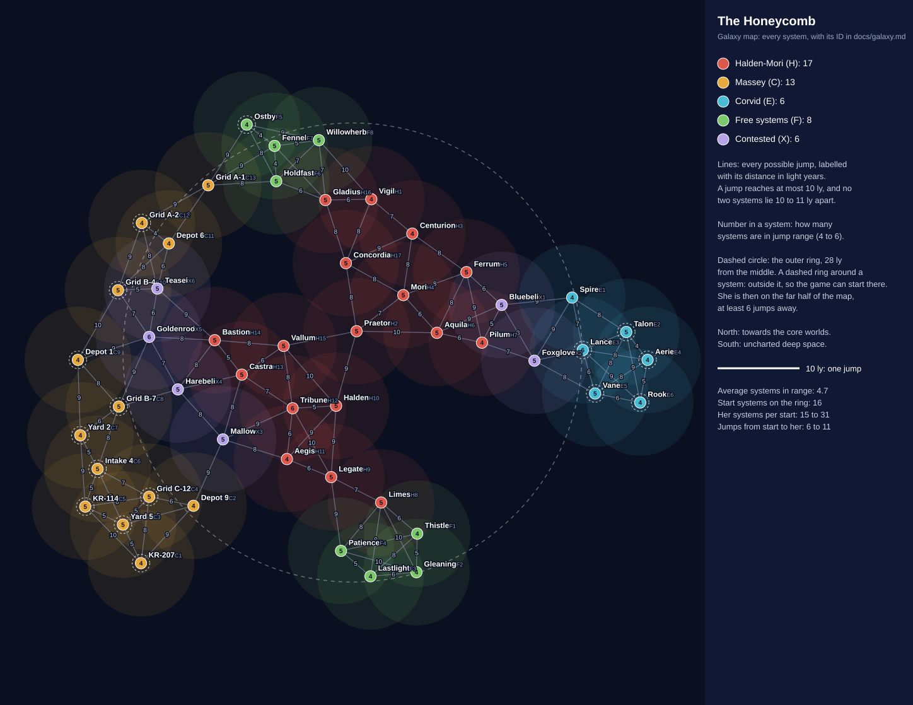

# Galaxy

> The world the game is set in: its star systems, the planets, moons, asteroid belts and other places in them, and
> the factions at war over them. Lore and names live here. Mechanics (star map, intel, travel) live in
> [game-design.md](game-design.md), and build status in [roadmap.md](roadmap.md). Mark undecided items as **TBD**.

## 1. A fixed galaxy

The galaxy is hand-made and the same in every playthrough: every star system has a fixed position on the star map,
a name, its planets and other places, and an owner.

What changes from one playthrough to the next:

- The start system and her location, both random (see [Finding her](game-design.md#finding-her)).
- Which systems sell the cure's ingredients and androids, and which hubs know she passed through: the hidden pacing
  picks them from the systems in reach.
- The ships and stations to board in every system, rolled every time like the wrecks of 010.

Why fixed rather than random:

- **The war needs territory.** Factions hold whole regions, with front lines and contested systems between them.
  Placing systems at random would scatter every faction's territory too.
- **Lore is written once.** Names, histories and hub stills can refer to neighbouring systems, front lines and past
  battles, and stay true.
- **Simpler pacing.** The pacing places ingredients and androids in systems that already exist, instead of adding
  new systems to the map.

**No fog of war.** The whole map is visible from the start: on a fixed map, fog would only hide what a returning
player already knows. What he can't see is what is in another system right now, its ships and stations, until he
arrives or buys intel on it at a hub (see [Mechanics](game-design.md#mechanics)). The random start, her random
location and the pacing make every journey a different route.

## 2. The war

- **The prize is antimatter.** It is harvested from the radiation belts of the rim's gas giants, and every jump drive
  runs on it.
- **Mercenary army companies fight it.** Rich powers off the map hire them rather than fight their own wars. Her
  company is one of them, probably the biggest. Each company runs the systems it holds, which is why on the rim the
  company is the nearest thing to law.
- **It has gone on for decades,** on and off, long enough for every system to have its battlefields and derelicts.
- **A neutral trader guild, the Hanse, runs every hub.** Every side needs it, so nobody touches it. That is why every system has
  a hub and why trading there is safe, and the rim pays in bitcoin because nobody trusts anyone else's money.
- **It explains the fuel.** Antimatter takes days to procure because the companies take most of it, and it gets
  scarcer as the war drags on: the in-world reason procurement times grow through the game (see
  [Travel and fuel](game-design.md#travel-and-fuel)).

## 3. Factions

Their names, founders and personalities are in [characters.md](characters.md); this is where they stand.

| Faction | Kind | Holds |
|---------|------|-------|
| Her company, Halden-Mori | The biggest mercenary army, and a weapons maker too | The largest territory, in the middle of the map |
| The cheap rival, Massey | A mercenary company that fights with masses of cheap drones and conscripts | A large region on one side |
| The elite rival, Corvid | A small, expensive, high-tech mercenary company, hired as specialists | A few well-held systems on the other side |
| Free systems | Independent colonies and miners, owned by nobody | Scattered pockets the companies haven't taken or couldn't hold |
| The trader guild, the Hanse | Neutral; runs every trader hub | No territory, but a hub in every system |
| Salvagers and pirates | Freelancers, the man among them; later the human enemies | Nothing: they live in the gaps |
| The patrons, the Concord and the Sol Directorate | The rich powers that hire the companies | Off the map, only ever mentioned |

- Each company holds one connected region. The systems along the borders are contested, and that is where the
  freshest battlefields are.
- **The front is static.** Territory never changes during a playthrough, which keeps a playthrough short and the map
  readable.
- Ownership is flavour only: it sets the hub's look and name, whose wrecks fill the battlefields and the news in hub
  stills. It never makes a system riskier or richer (see
  [Progression and difficulty](game-design.md#progression-and-difficulty)).
- Her company's ships turn up everywhere: mercenaries go where the contracts are, so the encrypted drives aren't tied
  to its territory.

## 4. The map

- **50 star systems** in a round stretch of the rim, about 75 light years across. North is towards the core worlds,
  where the patrons are; south is uncharted deep space.
- **The Honeycomb,** as the settlers named the cluster: its stars lie unusually close together, and almost every
  system has a world humans can live on, which is rare anywhere else on the rim. That brought the settlers, and the
  antimatter brought the war.
- **A jump reaches at most 10 light years,** all the ship's antimatter tank holds, so the distances decide where the
  player can go. Every system has 4 to 6 others in range, about 5 on average, and no two systems lie 10 to 11 ly
  apart, so a system is clearly in range or clearly not.

| Territory | Systems | Where |
|-----------|---------|-------|
| Her company | 17 | The middle |
| The cheap rival | 13 | A crescent around the west |
| The elite rival | 6 | A tight cluster in the east |
| Free systems | 8 | Two pockets of four, in the north and the south |
| Contested | 6 | Between her company and the rivals: four in the west, two in the east |

- **Why the companies hold their regions.** A company's systems lie close together, but none lies within a jump of
  another company's: the only ways across are through contested and free systems. Every contested system is a
  crossing, which is why it is fought over, and the elite rival can only be reached through its two.
- **Start and her location.** The game starts in a random system on the outer ring, 28 ly or more from the middle
  (16 systems), picked by a random direction so that the cheap rival's long west edge isn't favoured. She is in a
  random system on the far half of the map from the start, at least 6 jumps away. Every start leaves 15 to 31
  systems for her, 6 to 11 jumps away and 7.5 on average, which fits the 15 to 18 systems a journey crosses.
- **The layout is data.** The positions are in [galaxy.json](../art-source/galaxy/galaxy.json), and
  [galaxy_map.py](../art-source/galaxy/galaxy_map.py) checks them against these rules and draws the map (with
  `generate`, it first searches for a new layout). Every system also has an ID (H2, C9, ...), used in the data and
  shown small on the map. The names and history are pinned to where the systems lie, so move systems by hand rather
  than generating a new layout. [systems.py](../art-source/galaxy/systems.py) turns section 8's tables and the
  positions into the game's star system content, so rerun it after changing a system here.

## 5. What a system holds

Systems vary a lot: a red dwarf with one belt and the hub plays very differently from a big system with eight places.

- **A star:** a red dwarf, a yellow or white star, a binary pair, or a dead neutron star.
- **A trader hub:** always a guild station.
- **Two to eight places,** of these kinds:

| Kind | What it is |
|------|------------|
| Planet | Rocky, ice or a gas giant. Almost every system has a habitable world, with settlements. Gas giants are the war's prize, with antimatter harvesters, refineries and garrisons |
| Moon | A moon of one of the planets |
| Asteroid belt | Ore, mining outposts and places to hide |
| Station | A company base, a mining outpost or a shipyard |
| Battlefield | A debris field, named after the fight that made it |
| Anomaly | Something strange: a rogue planet, an ion storm, a graveyard of drifting hulls |

- **Ships to board** can be at any of these places, or out in open space.

## 6. History

Names come in layers: the survey numbered every star, settlers renamed what they settled, companies renamed what
they took, and battles named the places they were fought. So a system's name tells its history (see
[Naming](#7-naming)).

| When | Era | What happened, and where |
|------|-----|--------------------------|
| About 300 years ago | The survey | A survey ship from the core charted the cluster and numbered every star. Systems nobody settled still go by those numbers |
| 300 to 150 years ago | The settling | Settlers came for the habitable worlds. The first landing was at Hearth, in the middle, which became the settlers' capital. Colonies spread out from there, named after home, founders and hopes |
| About 150 years ago | The antimatter rush | The gas giants turned out to hold antimatter in their radiation belts. The core powers wanted it and paid companies to "protect" the harvest |
| About 70 years ago | The first company war | Halden-Mori, paid by the Concord, took the middle. In the fall of Hearth the settlers' capital fell, and the company renamed its system Praetor, its regional headquarters. The northern colonies (Ostby, Holdfast, Fennel, Willowherb) held out through the siege of Holdfast, which is why they are still free. The southern pocket (Thistle, Patience, Gleaning, Lastlight), on the deep-space side, was too poor to bother with |
| About 50 years ago | The rivals arrive | The Sol Directorate hired Massey, which swarmed in from the west, and Corvid, which took the east and dug in behind its two crossings, Bluebell and Foxglove |
| The last 40 years | The long war | The western front swings back and forth through Mallow, Harebell, Goldenrod and Teasel, and Goldenrod holds the Long Fall, the biggest battlefield on the rim. In the east, Halden-Mori has failed to break through at Foxglove more than once: a stalemate |
| Now | The present | The west is a hot front, with fresh battlefields at Harebell and Goldenrod. The east is quiet. The free north trades with every side to survive |

Her company's bioweapons station lies coreward, beyond the north edge of the map. She fled away from it, out into
the rim, so it is only ever mentioned, never visited.

## 7. Naming

A system's name follows its history, layer on layer:

| Layer | Who named it | Style | Examples |
|-------|--------------|-------|----------|
| Survey numbers | The core survey | A catalogue code, kept only by the few systems nobody settled: barren worlds, neutron stars | KR-114, KR-207 |
| Settlers' names | The first colonists | Flowers and fields that bees feed on, and homes, founders and hopes | Clover, Linden, Heather, Thyme, New Galway, Founders' Rest |
| Halden-Mori | Its renames of what it took | Hard, corporate-military, Latin-flavoured | Bastion, Praetor, Aegis |
| Massey | Its renames | It doesn't bother: logistics codes, Depot (supply hubs), Yard (drone factories), Intake (conscript camps) and Grid with a letter and number for the rest | Depot 9, Yard 2, Intake 4, Grid C-12 |
| Corvid | Its renames | Single sharp words | Spire, Lance, Aerie |
| Battles | Whoever survived | The battle's name, given to its battlefield | the Long Fall, the Ash Ring |

- **Contested systems keep their settler names:** nobody holds them long enough to rename them, and the trader guild
  charts them by those names.
- **Conquered systems keep their worlds' settler names.** A company renames the system, but its habitable world keeps
  the name the settlers gave it, and the locals still call the system by it: Praetor is Halden-Mori's name, but its
  world, and to the locals the whole system, is Hearth. The map shows the owner's name; hub stills and logs can use
  the old one.
- **Places in a system:** planets are numbered after the star (Clover II), but every habitable world has a name of
  its own; moons take letters (Clover II-b) unless someone settled them; belts and anomalies get descriptive names
  (the Rattle, the Hush).
- Founders, companies and other people that names refer to are in [characters.md](characters.md).

## 8. Star systems

By territory, with the map's IDs. Places are listed from the star outwards; bold names are habitable worlds.

### Halden-Mori

| ID | Where | System | Star | Places |
|----|-------|--------|------|--------|
| H2 | Middle | Praetor | Yellow | Praetor I (scorched rock) · **Hearth** (II): the settlers' capital, now Halden-Mori's regional headquarters · **Calloway** (II-b, a settled moon) · Praetor IV (gas giant, harvesters) · the Granary (belt) · Dray's Gate (the headquarters fortress) |
| H4 | Middle, north-east | Mori | White | **Clover** (II): Mori's arms works · Mori III (gas giant) · III-a (moon, weapon test ranges) · the Range (a belt used as a firing range) · Mori Yards (shipyard) |
| H10 | Middle, south | Halden | Binary | **Thyme** (II): barracks and training grounds · Halden III (ice) · the Drill Field (a belt of target hulks) · Halden Muster (troop depot) |
| H15 | Middle, west | Vallum | Red dwarf | **Heather** (I): farms · Vallum II (rock) · the Picket (a belt of sensor buoys) |
| H13 | West | Castra | Yellow | **New Galway** (II) · Castra III (gas giant, harvesters) · III-c (moon, forward base) · Castra Depot (supply station) |
| H14 | West front | Bastion | White | **Borage** (II): bunkered · Bastion IV (gas giant, harvesters) · the Shield (mined belt) · Bastion Fort (station) · the Scorch (battlefield from Massey's raids) |
| H11 | South-west | Aegis | Yellow | **Sweetwater** (II) · Aegis III (ice) · Aegis Array (a sensor station watching the west) |
| H12 | South-west | Tribune | Red dwarf | **Marigold** (I) · the Tithe (an ore belt Halden-Mori taxes) |
| H9 | South | Legate | Yellow | Legate I (rock) · **Founders' Rest** (II): where the Calloways are buried · Legate III (gas giant, harvesters) · III-a and III-b (moons) · the Orchard (a belt of settler mining co-ops) · Legate Station (administration) |
| H8 | South edge | Limes | Red dwarf | **Clearwater** (I) · the Fence (a belt of patrol posts facing the free south) |
| H6 | East | Aquila | White | **Lavender** (II) · Aquila III (gas giant, harvesters) · III-a (moon) · Eagle's Roost (carrier base) |
| H7 | East front | Pilum | Yellow | **Bramble** (II) · Pilum IV (gas giant) · the Wake (anomaly: an ion storm) · Pilum Staging (where the assaults on X2 begin) |
| H5 | North-east | Ferrum | Red dwarf | Ferrum I and II (mined rock) · **Meadowsweet** (II-a, a settled moon) · the Ironfield (mining belt) |
| H3 | North-east | Centurion | Yellow | **Buckwheat** (II) · Centurion III (gas giant, harvesters) · III-a (moon) · the Hundred (a belt of a hundred mining claims) |
| H17 | North, towards the core | Concordia | Binary | **Linden** (II) · Concordia IV (gas giant, the cluster's biggest harvester) · Concordia Gate (where the Concord's convoys arrive from the core) · the Lantern (anomaly: a glowing nebula pocket) |
| H1 | North | Vigil | Red dwarf | **Hollyhock** (I) · Vigil Watch (a listening post facing the free north) · the Hush (anomaly: a radio-dead zone) |
| H16 | North | Gladius | Yellow | **Acacia** (II) · Gladius III (ice) · the Siege Belt (where the siege of F6 was staged) · Gladius Barracks (station) |

### Massey

A planet's full name is the system's name and its numeral (Depot 1 III).

| ID | Where | System | Star | Places |
|----|-------|--------|------|--------|
| C9 | Far west | Depot 1 | Yellow | **Rosemary** (II): Massey's regional headquarters, where the swarm first landed · III (gas giant, harvesters) · III-a (moon, drone hangars) · the Stockyard (a belt where swarms are parked) · Depot 1 Station (supply hub) |
| C7 | Far west | Yard 2 | Red dwarf | **Coltsfoot** (I): drone factories, choked in smog · II (strip-mined rock) · the Slag (a belt of factory waste) |
| C6 | Far west | Intake 4 | Yellow | **Poppy** (II): conscript camps · III (ice) · the Pens (the conscript barracks station) |
| C8 | West | Grid B-7 | White | **Chicory** (II) · III (gas giant, harvesters) · III-a and III-b (moons) · the Chaff (a belt full of drone decoys) |
| C10 | West | Grid B-4 | Red dwarf | **Yarrow** (I) · the Gnat Cloud (battlefield: a cloud of dead drones from the fall of the west) |
| C12 | North-west | Grid A-2 | Yellow | **Sorrel** (II) · III (gas giant) · the Long Furrow (belt) |
| C13 | North-west, on the free north's border | Grid A-1 | White | **Tansy** (II): smugglers trade with the free north here · III (ice) · the Narrows (a belt along the smuggling route north) |
| C11 | North-west, towards the front | Depot 6 | Yellow | **New Antrim** (II) · III (gas giant, harvesters) · III-a (moon, drone hangars) · Depot 6 Station (forward supply for the battles at X5) · the Fallow (belt) |
| C2 | South-west, towards the front | Depot 9 | Binary | **Goodhope** (II) · III (ice) · Depot 9 Station (forward supply facing X3) · the Spill (anomaly: antimatter still leaking from a wrecked tanker) |
| C4 | South-west | Grid C-12 | Yellow | **Bergamot** (II) · III (rock) · IV (gas giant, harvesters) · IV-a and IV-b (moons) · the Tumble (belt) |
| C3 | Far south-west | Yard 5 | White | **Cornflower** (II): drone factories · III (gas giant, harvesters) · the Boneyard (a belt of scrapped drones and hulls that Massey recycles) |
| C1 | Far south-west | KR-207 | Neutron star | No habitable world: I (irradiated rock) · the Glare (anomaly: the star's radiation storms) |
| C5 | South-west, the outermost system | KR-114 | Red dwarf | No habitable world: I (ice) · II (rock) · the Drift (belt) · the Edge (anomaly: where the charts end and deep space begins) |

### Corvid

Corvid renames even the barren system it holds, because it hides something there.

| ID | Where | System | Star | Places |
|----|-------|--------|------|--------|
| E4 | Far east, the deepest | Aerie | White | **Primrose** (II): Corvid's headquarters, a fortified research city · Aerie III (gas giant, harvesters) · III-a (moon): the Rookery, Corvid's training school · Aerie Station (command) |
| E2 | East | Talon | Yellow | **Saffron** (II) · Talon III (gas giant, harvesters) · the Mirror Field (a belt seeded with sensor mirrors) |
| E6 | South-east, the rear | Rook | Red dwarf | **Camomile** (I) · the Hollow (anomaly: a rogue planet drifting through) · Rook Listening Post (station) |
| E1 | West, covering the crossing at X1 | Spire | Yellow | **Juniper** (II) · Spire III (ice) · Spire Watch (a tower of sensors watching X1) · the Thorn Belt (mined belt) |
| E3 | West, covering the crossing at X2 | Lance | Binary | **Elderflower** (II) · Lance III (gas giant, harvesters) · III-a and III-b (moons) · Lance Battery (the long guns that cover X2) |
| E5 | South-west, near X2 | Vane | Neutron star | No habitable world: Vane I (irradiated rock) · Vane Labs (Corvid's black-site research, shielded from the star) · the Pulse (anomaly: the neutron star's sweeping beam) |

### Free systems

Nobody renamed them, so their names are the settlers' own. The free north is Maren Ostby's colonies: proud, trading
with every side and marked by the siege. The free south was too poor to conquer; its names are hard-luck hopes, and
it has become the salvagers' home ground.

| ID | Where | System | Star | Places |
|----|-------|--------|------|--------|
| F5 | North, outer edge | Ostby | Yellow | **Northstead** (II): the free north's capital and biggest market, founded by Maren Ostby · Ostby III (gas giant, the free north's own harvesters) · III-a (moon) · the Commons (a belt of co-op mining claims) |
| F6 | North, facing Halden-Mori | Holdfast | White | **Wren** (II): renamed after the siege in honour of its defender · Holdfast III (rock) · Wren's Wall (battlefield: the siege lines, with Halden-Mori's wrecks still where they fell) · the Bulwark (fortified belt) |
| F7 | North, facing Massey | Fennel | Red dwarf | **Fennel** (I): a trading post with Massey's Grid A-1, legal or not · the Lees (anomaly: a dust nebula where ships hide) |
| F8 | North, facing Vigil | Willowherb | Yellow | **Willowherb** (II): the north's farm world, regrown after the war like the fireweed it is named for · Willowherb III (ice) · III-a and III-b (moons) · the Hedgerow (belt) |
| F1 | South, facing Halden-Mori's Fence | Thistle | Red dwarf | **Thistle** (I): hardscrabble farms · the Burrs (a belt of small independent miners) |
| F4 | South | Patience | Yellow | **Patience** (II) · Patience III (gas giant, unharvested: the south can't afford harvesters) · III-a (moon) · the Waiting (anomaly: a slow gravity eddy that collects drifting wrecks) |
| F2 | South-east | Gleaning | Binary | **Gleaning** (II): the salvagers' haven, where wreck-pickers trade, refit and drink; gleaners pick the fields after the harvest · Gleaning III (ice) · the Pickings (a belt of towed-in wrecks being stripped) |
| F3 | South, the edge of deep space | Lastlight | Red dwarf | **Lastlight** (I): the last settled world before deep space · the Cometfall (a comet cloud) · the Long Dark (anomaly: uncharted space beginning past the comets) |

### Contested systems

They keep their settler names: nobody holds them long enough to rename them. Each one is a crossing between
territories, scarred to match. The western four are the hot front; the eastern two, a frozen stalemate under Corvid's
guns.

| ID | Where | System | Star | Places |
|----|-------|--------|------|--------|
| X5 | West front, between Bastion and Massey | Goldenrod | Yellow | **Goldenrod** (II): its people live underground, and the Hanse hub never closes · Goldenrod III (gas giant, its harvesters wrecked and rebuilt by each side in turn) · III-a (moon) · the Long Fall (battlefield: where Pike's swarm broke against Halden-Mori's lines, the biggest on the rim and still growing) |
| X4 | West front | Harebell | Red dwarf | **Harebell** (I) · Harebell II (rock, cratered by bombardment) · the Ash Ring (battlefield, still burning from this year's fighting) |
| X6 | North-west front | Teasel | White | **Teasel** (II) · Teasel III (ice) · the Tangle (a belt sown with both sides' mines) |
| X3 | South-west front | Mallow | Yellow | **Mallow** (II) · Mallow III (gas giant, its harvesters have changed hands a dozen times) · the Scatter (battlefield: wreckage strewn across the system by running fights) · the Red Mist (anomaly: a red gas cloud) |
| X1 | East crossing | Bluebell | White | **Bluebell** (II) · Bluebell III (gas giant) · the Quiet Line (where the two sides' pickets watch each other across the stalemate) |
| X2 | East crossing | Foxglove | Binary | **Foxglove** (II) · Foxglove III (ice) · III-a (moon) · Quill's Stand (battlefield: the wrecks of Halden-Mori's failed assaults, lying under Lance's guns) |

## 9. Open questions

None right now.
